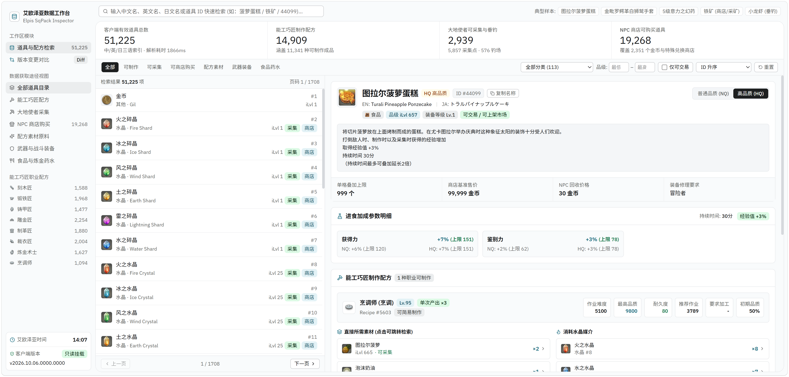

# XIV Data Analyzer

基于 [ffcafe/elpis](https://github.com/thewakingsands/elpis) 的本地最终幻想XIV游戏数据解析展示工具。



---

## 本地部署与运行步骤

### 1. 环境准备
需要 [Node.js](https://nodejs.org/) ，推荐18.0或更高版本。

### 2. 安装依赖
```bash
npm install
```

### 3. 配置客户端路径
参考 `.env.example` 文件，新建并配置 `.env`

### 4. 启动服务
```bash
npm run dev
```